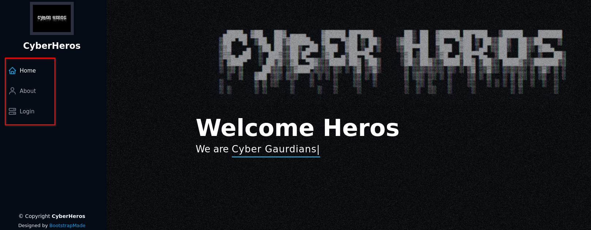
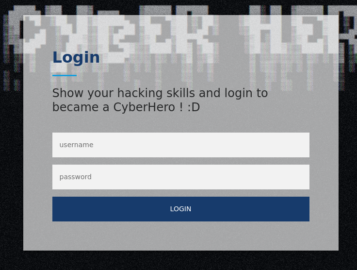
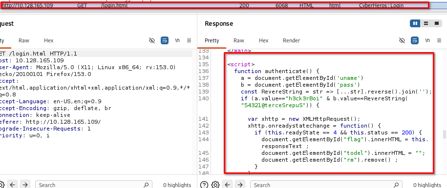
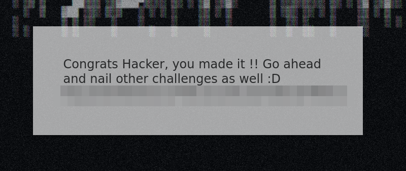

# CiberHeroes

Time: 30 minutes

Difficulty: Easy

Link: https://tryhackme.com/room/cyberheroes

## What is about?

This challenge is aim to begginers and you need to bypass the login page to enter as an user.

## Challenge

1. Navigate to the web url `http://IP_MACHINE` and start exploring the site. It have 3 differents sections: *Home*, *About*, *Login*. The interesting one is the Login section.

     

2. Go to Login and encounter a login page which you need to fill a username and a password.

     

3. In Burp suite look into the response and find that there is a function of how it works the login. Notice that the same function indicates the username and the password. However, the password need to be put in reverse because of the function `RevereString()`.
     

4. Log in as `h3ck3rBoi` with the password `SuperSecret@12345` and notice how the page return the flag to complete the challenge.
     

## Conclusion

This challenge did not represent a challenge for me, it was very straight foward.